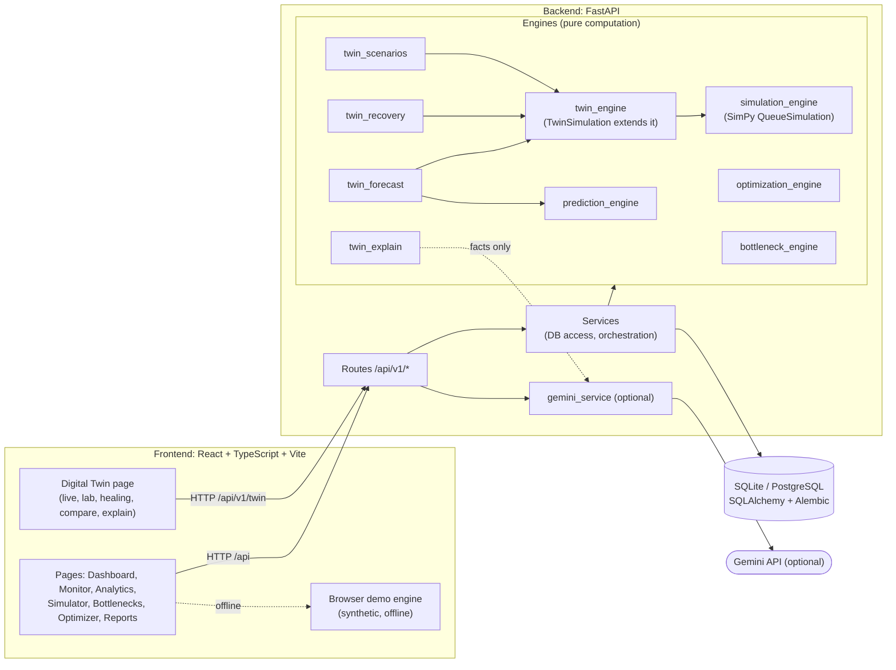
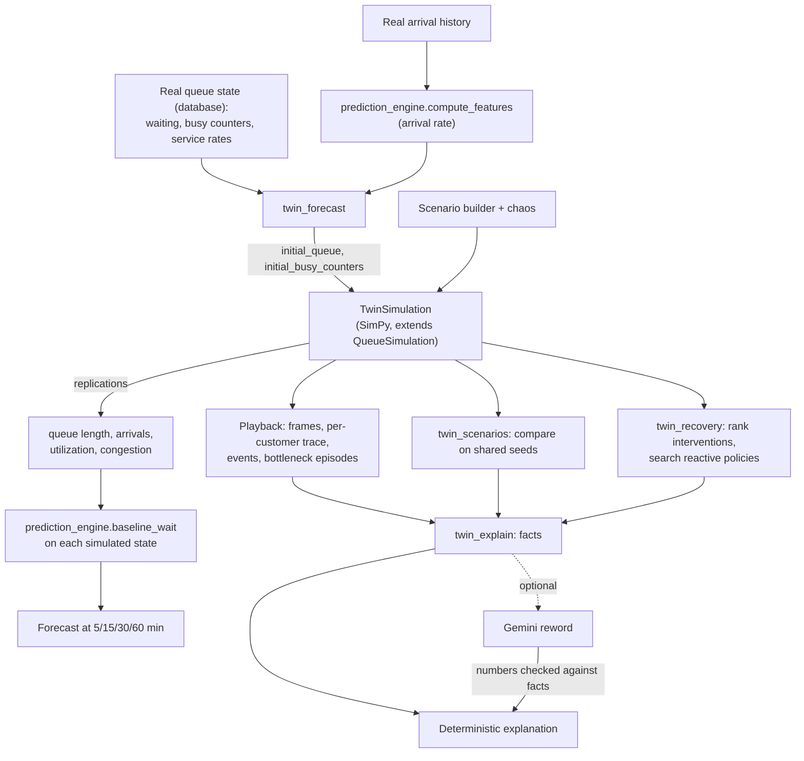

# LineZero

**Queue intelligence for service counters: monitor, predict, simulate, optimize, and now stress-test with a Digital Twin.**

LineZero is a full-stack application (FastAPI + SimPy backend, React + TypeScript frontend) that helps an operations team understand and fix waiting lines. It manages live queues and counters, forecasts waiting times, finds bottlenecks, simulates what-if scenarios, recommends better resource allocation, and produces reports.

The **Digital Twin** module (`/app/digital-twin`, tagline *Predict. Simulate. Optimize. Recover.*) adds a simulation twin of a queue: it starts from the queue's real current state, projects it forward 5 to 60 minutes, lets you inject failures and surges, and evaluates recovery plans, all inside a simulation that never touches the real queue.

> **Status note.** Everything in this README describes code that exists in this repository. No accuracy percentages, benchmarks, user counts or third-party integrations are claimed, because none have been measured. Where a number is produced, it is produced by running the simulation or the prediction engine, and the UI says so.

---

## Table of contents

1. [Project overview](#1-project-overview)
2. [Problem statement](#2-problem-statement)
3. [Solution and objectives](#3-solution-and-objectives)
4. [Major features](#4-major-features)
5. [Digital Twin](#5-digital-twin)
6. [System architecture](#6-system-architecture)
7. [Technology stack](#7-technology-stack)
8. [Simulation and prediction methodology](#8-simulation-and-prediction-methodology)
9. [Self-healing optimization](#9-self-healing-optimization)
10. [Real data vs synthetic data vs predictions vs simulations](#10-real-data-vs-synthetic-data-vs-predictions-vs-simulations)
11. [API integrations (Gemini)](#11-api-integrations-gemini)
12. [Project structure](#12-project-structure)
13. [Installation requirements](#13-installation-requirements)
14. [Local setup: backend](#14-local-setup-backend)
15. [Local setup: frontend](#15-local-setup-frontend)
16. [Environment variables](#16-environment-variables)
17. [API endpoints](#17-api-endpoints)
18. [Database and migrations](#18-database-and-migrations)
19. [Testing](#19-testing)
20. [Screenshots](#20-screenshots)
21. [Deployment](#21-deployment)
22. [Limitations and future scope](#22-limitations-and-future-scope)

---

> **LineZero 2.0: Adaptive Intelligence** (*Predict. Understand. Intervene. Learn.*) adds a closed loop on top of the Digital Twin: a twin that calibrates itself from observed data (validated, versioned, reversible), explainable operational risk detection, simulated and costed intervention proposals that **people approve and carry out**, and outcome learning that keeps real, synthetic and operator-reported results apart. LineZero never executes an intervention. Methods, formulas, workflow and limitations: [docs/ADAPTIVE_INTELLIGENCE.md](docs/ADAPTIVE_INTELLIGENCE.md). New API: [docs/API_REFERENCE.md](docs/API_REFERENCE.md#adaptive-intelligence-linezero-20). New pages (server mode): Adaptive Intelligence, Operational Risk Radar, Autonomous Interventions, Outcome Learning.

## 1. Project overview

LineZero has three layers:

| Layer | What it is |
|---|---|
| **Operate** | Queues, counters and customers (tokens) stored in a database. Serve, assign, complete and remove customers; watch the live monitor. |
| **Analyze** | Analytics (arrivals, waits, utilization, peak hours), waiting-time prediction, statistical bottleneck detection, and a discrete-event simulator. |
| **Optimize and recover** | A resource optimizer that compares allocations by simulation, and the Digital Twin: forecasting, chaos engineering, scenario comparison and self-healing recovery planning. |

The frontend also ships a self-contained **browser demo mode** (synthetic data, no backend needed). The Digital Twin is the exception: it needs the backend, because its engines (SimPy, scikit-learn) run server-side.

## 2. Problem statement

Waiting lines at service counters (clinics, banks, government offices, campus services) degrade quickly once demand approaches capacity. Operators usually see only the current queue length. They cannot easily answer:

- *How long will the line be in 15 or 60 minutes if nothing changes?*
- *What happens if a counter breaks, a staff member is absent, or arrivals double?*
- *Which counter is the real bottleneck, and which fix would help most before I spend money on it?*

Experimenting on a live queue is not an option: it hurts real customers.

## 3. Solution and objectives

LineZero answers those questions on a **model of the queue** instead of the queue itself.

Objectives:

1. Show the real current state of a queue and the customers waiting.
2. Forecast queue length, waiting time, arrivals, utilization and congestion risk at 5, 15, 30 and 60 minutes.
3. Let a user change demand, service speed, counters, staffing and abandonment, and inject failures, and see the consequences with measured statistics.
4. Recommend recovery actions, rank them by simulated benefit, and report the before-and-after difference, never changing production queues automatically.
5. Stay honest: every figure is traceable to a simulation run, the prediction engine, or the database, and uncertain results are labelled as such.

## 4. Major features

| Area | Feature | Where |
|---|---|---|
| Operate | Queue/counter/customer management, serve-next, assign, complete, live monitor | `/app/monitor`, `/api/v1/queues`, `/api/v1/counters` |
| Analyze | Dashboard, analytics (arrivals, waits, utilization, peak hours) | `/app/dashboard`, `/app/analytics` |
| Analyze | Waiting-time prediction (statistical baseline plus optional ML, validated on a hold-out set) | `/api/v1/predictions` |
| Analyze | Bottleneck detection (five statistical rules with evidence) | `/app/bottlenecks` |
| Analyze | SimPy queue simulator with M/M/c reference values | `/app/simulator` |
| Optimize | Resource optimizer (candidate allocations compared by replicated simulation) | `/app/optimizer` |
| Report | JSON, CSV and PDF reports | `/app/reports` |
| **New** | **Digital Twin: live twin, forecasting, what-if, chaos, self-healing, comparison, timeline, explanations** | `/app/digital-twin`, `/api/v1/twin` |

## 5. Digital Twin

Route: **`/app/digital-twin`** (sidebar: *Optimize → Digital Twin*). Requires the backend and "Server data" mode.

| Tab | What it does |
|---|---|
| **Live twin & forecast** | Animated floor view of the selected queue built from database state: customers waiting, counters idle/busy/closed, KPIs (queue length, longest and average wait, counter utilization, arrival rate, demand/capacity, operational status), the existing prediction engine's wait estimate, and a **5/15/30/60-minute forecast** of queue length, waiting time, arrivals, utilization and congestion risk. Auto-refreshes every 5 s. |
| **What-if & chaos** | Scenario builder (arrival rate, service duration, counters, staff availability, counter speed, simulation duration, abandonment) with six predefined scenarios: *Normal operations, Arrival surge, Staff shortage, Counter failure, Slow service, Peak-hour congestion*. **Chaos engineering:** counter failures, temporary outages, customer surges, slowed service, staff shortages, injectable at the playhead while the simulation plays. **Play / Pause / Resume / Reset**, adjustable speed (1x to 32x), scrubbing, an animated floor view with customers moving from arrival to queue to counter, and a **timeline** (arrival, queue formation, service start, service completion, counter failure, bottleneck detection, recovery actions). |
| **Self-healing** | Three modes: **Manual** (you schedule actions), **AI-assisted** (diagnosis plus simulation-ranked recommendations) and **Automatic** (a reactive recovery policy searched and played back in the simulation). Simulation only. |
| **Compare** | 2 to 5 scenarios on identical random seeds: average wait, P95 wait, max queue, customers served, abandonment, counter utilization, resource cost, with paired differences and before/after tables. Scenarios persist in browser `localStorage`. |
| **Explain** | Four questions (why did congestion occur, which counter is overloaded, which intervention works best, how do scenarios differ). Answered by a built-in deterministic explainer; optionally reworded by Gemini under strict grounding rules (see [section 11](#11-api-integrations-gemini)). |

**The Digital Twin never writes to real queues.** The only database access is read-only (queue state, counters, history). `GET /api/v1/twin/status` reports `writes_to_real_queues: false`, and a test verifies a forecast leaves the queue unchanged.

## 6. System architecture



### How the Digital Twin reuses existing engines



Design rules: engines are pure functions of their inputs (no database, no HTTP); services own database access; routes are thin; the original `QueueSimulation` is **not modified**: `TwinSimulation` subclasses it, and a test asserts identical results to the original engine when no twin features are used.

## 7. Technology stack

**Backend** (Python 3.11+): FastAPI, Uvicorn, Pydantic v2, SQLAlchemy 2, Alembic, SQLite (PostgreSQL-compatible schema), NumPy, Pandas, SciPy, scikit-learn, SimPy, ReportLab (PDF export), HTTPX, Pytest.

**Frontend**: React 18, TypeScript, Vite, React Router, Zustand, Recharts, lucide-react, GSAP/Lenis/three.js (landing page), jsPDF (browser-demo export), Vitest, Playwright.

**Optional external service**: Google Gemini API (explanations only).

## 8. Simulation and prediction methodology

### Discrete-event simulation (SimPy)

The base engine (`engines/simulation_engine.py`) simulates arrivals (Poisson, deterministic or uniform), service times (exponential, deterministic, uniform, lognormal), several counters sharing one FIFO queue, optional abandonment, per-counter speed factors and time-varying arrival rates. One time unit is one minute.

`engines/twin_engine.py` adds, by subclassing:

- **Counter outages** with optional repair time. A failure is *graceful*: the customer being served finishes, then the counter goes offline.
- **Time-limited slow-downs** of one or all counters.
- **Closed counters at start**: reserve (standby) counters and counters with no staff (`staff_available`).
- **Recovery actions**: scheduled (activate a counter, close a counter, staff-assist speed boost) or reactive (see [section 9](#9-self-healing-optimization)).
- **Starting from live state**: customers already waiting and counters already busy.
- **Playback data**: periodic frames (queue, counter states), a per-customer trace, an event log, and bottleneck episodes with the most loaded counter taken from the trace.

Limits: runs are limited to about 8,000 customers; the shared-queue model means "redistributing customers" is represented by the assignment strategy only.

### Replications and comparison

Every analysis runs several independent seeds (`base_seed, base_seed+1, …`). Scenarios being compared use the **same seeds** (common random numbers), so differences are paired. Results are reported as means with 95% t-intervals; a difference is called *clear* only if the paired 95% interval excludes zero, otherwise *within noise*.

Reported P95 waiting time includes customers still waiting when the run ends (a lower bound for them), so a run that ends with a long unserved queue is not made to look good.

### Forecast (5/15/30/60 minutes)

1. Read the **current queue state** from the database: customers waiting, which counters are busy, each counter's service rate.
2. Take the **recent arrival rate** from the existing prediction engine (`compute_features`, last 30 minutes of real arrivals); if there are none, fall back to the historical average and say so.
3. Start 5 to 200 SimPy replications (the UI uses 40) from that state and run them for 60 minutes.
4. Read queue length, arrivals since now, utilization and congestion at each horizon. **Waiting time** is computed by applying the prediction engine's `baseline_wait` formula to each simulated state, so forecasts and live predictions share one definition.

Assumptions (also returned by the API): arrival rate and counter speeds are constant over the horizon; exponential service; no abandonment; no failures. The p10 to p90 range is variability across replications, **not a validated prediction interval**, and no accuracy figure is claimed.

### Waiting-time prediction (existing)

A transparent baseline `wait = max(L + 1 − idle, 0) / capacity`, plus optional Linear Regression / Random Forest models that are trained only with at least 100 usable history samples, judged on a chronological hold-out set, and used only if they beat the baseline by at least 5% MAE. See `backend/README.md` for details.

## 9. Self-healing optimization

All three modes evaluate plans **inside the simulation**. Nothing is applied to a real queue.

| Mode | How it works |
|---|---|
| **Manual** | You add actions (activate counter, close counter, staff assist) at chosen times. The twin runs *unmanaged* vs *with your actions* on the same seeds and shows the before/after table. |
| **AI-assisted** | `recommend()` runs the scenario, diagnoses it (first congestion time, most loaded counter, underused/closed/failed counters), generates candidate interventions (open 1 to 3 reserve counters, assisting staff, switch assignment strategy, combined), simulates every candidate on the same seeds, and ranks them by score. A recommendation is only marked *recommended* if it improves the score by more than simulation noise and stays within an optional cost cap. "AI-assisted" here means algorithmic recommendation; Gemini only explains the result and never ranks anything. |
| **Automatic** | `auto_recover()` searches reactive policies (when the queue stays at or above a threshold for a minute, open a closed counter, then optionally add assisting staff), picks the best, and returns before/after statistics plus the recovered run for playback, with recovery actions visible on the timeline. |

Score (lower is better): `score = avg_wait + 0.5 × p95_wait + 20 × abandonment_rate`. These weights are design choices, returned with every response. The speed-up for assisting staff (default ×1.15) is an **assumption**, shown as such in the UI. Results are the best of the evaluated family, not a proof of global optimality.

## 10. Real data vs synthetic data vs predictions vs simulations

| Item | Source | Label in UI/API |
|---|---|---|
| Queues, counters, tokens, completed/abandoned totals | **Database.** Real if you entered real data; **synthetic** if loaded with the demo seeder | `is_synthetic` flag; "synthetic demo data" |
| Current waiting list, busy/idle counters, current wait times, utilization now | **Database state** at request time | "Live twin" tab; `data_provenance` |
| Recent arrival rate | **Computed from database history** by the prediction engine | `arrival_rate_source` |
| "Predicted wait if you join now" | **Prediction** (statistical baseline or validated ML) | method shown |
| 5/15/30/60-minute forecast | **Simulation** started from real state | `method: replicated_simpy_from_live_state`; assumptions listed |
| What-if, chaos, comparison, recovery results | **Pure simulation** from the parameters you entered | "simulation" chip |
| Preset sizes (surge ×2, 40% staff shortage, 30% slowdown, failure window) and staff-assist ×1.15 | **Illustrative assumptions**, not measured | listed under each preset and recommendation |
| Demo seed data | **Synthetic**, generated by `python -m app.seed.generate_demo_data` | `[SYNTHETIC]` queue names, `is_synthetic` |
| Browser demo mode | **Synthetic**, in-browser | "BROWSER DEMO" pill |

Note: for synthetic queues whose data ended when they were generated, the twin anchors arrival-rate estimation at the latest activity (existing `resolve_as_of` rule) so they remain usable.

## 11. API integrations (Gemini)

Gemini is **optional**. Without a key the Digital Twin is fully functional and uses a deterministic explainer.

- Set `GEMINI_API_KEY` (and optionally `GEMINI_MODEL`, default `gemini-2.0-flash`) in `backend/.env`. The key is read **only on the backend**, never sent to the browser, never logged, never returned by any endpoint (`/twin/status` returns only `configured` and the model name).
- **What Gemini receives:** a compact JSON of aggregated facts that the backend just computed (scenario parameters, summary metrics, bottleneck episodes, per-counter utilization, ranked interventions). No customer rows.
- **What Gemini may do:** explain why congestion occurred, which counter is overloaded, which intervention is most effective, and how scenarios differ.
- **What Gemini cannot do:** introduce metrics. Facts are recomputed server-side from the request (the client cannot supply facts), and any number in Gemini's answer that does not appear in the facts causes the answer to be **discarded** in favour of the deterministic explanation; the response says why. Limitation: this guard catches *invented* numbers, not a real number attached to the wrong quantity. The facts are shown under "Facts used" so a reader can check.
- Any failure (no key, network error, HTTP error, empty answer) also falls back to the deterministic explanation.

The Gemini call is covered by tests that use an injected fake generator; **no test calls the real Gemini service**, and the live HTTP call itself has not been exercised against Google's API in this repository's tests.

## 12. Project structure

```text
linezero/
├── README.md
├── docs/
│   ├── API_REFERENCE.md          # endpoint reference (Digital Twin and Adaptive Intelligence sections)
│   ├── ADAPTIVE_INTELLIGENCE.md  # LineZero 2.0 methods, workflow, limitations
│   └── FRONTEND_INTEGRATION.md
├── scripts/                      # start-backend / start-frontend (.sh, .ps1)
├── shared/queueing_fixtures.json # M/M/c reference values asserted by both test suites
├── backend/
│   ├── requirements.txt  pytest.ini  alembic.ini  .env.example
│   ├── alembic/versions/         # 0001_initial_schema, 0002_intelligence_layer, 0003_adaptive_intelligence
│   ├── app/
│   │   ├── main.py
│   │   ├── api/routes/           # queues, counters, simulation, intelligence, twin
│   │   ├── core/                 # config, database, errors, migrations, init_db
│   │   ├── engines/              # simulation, prediction, optimization, bottleneck, analytics, report,
│   │   │                         # twin_engine, twin_forecast, twin_scenarios, twin_recovery, twin_explain,
│   │                         # calibration_engine, drift_detection_engine, risk_engine, intervention_engine, outcome_engine
│   │   ├── models/               # SQLAlchemy models
│   │   ├── schemas/              # Pydantic schemas (incl. twin.py)
│   │   ├── services/             # DB-backed services (incl. twin_service.py, gemini_service.py)
│   │   └── seed/                 # synthetic demo-data generator
│   └── tests/                    # pytest (incl. test_twin_*.py)
└── frontend/
    ├── package.json  vite.config.ts  playwright.config.ts
    ├── e2e/                      # Playwright (incl. digital-twin.spec.ts)
    └── src/
        ├── api/                  # client, serverStore, types (incl. twinTypes.ts)
        ├── app/
        │   ├── pages/            # browser-demo pages
        │   ├── server/           # pages that render backend data
        │   ├── intelligence/     # Adaptive Intelligence, Risk Radar, Interventions, Outcome Learning pages
        │   ├── twin/             # Digital Twin UI (TwinPage, LivePanel, LabPanel, HealPanel,
        │   │                     #   ComparePanel, ExplainPanel, FloorView, ScenarioForm, usePlayback)
        │   └── shell/ ui/ charts/
        ├── lib/                  # demo engine, queue maths; twinPlayback.ts (+ __tests__)
        ├── store/  landing/  styles/ (incl. twin.css)
        └── main.tsx
```

## 13. Installation requirements

- **Python 3.11 or newer** (developed on 3.12)
- **Node.js 18 or newer** and npm (developed on Node 22)
- Git
- Optional: a Gemini API key; a Chromium browser for Playwright (`npx playwright install chromium`)

## 14. Local setup: backend

Quick start (creates a virtual environment, installs dependencies, migrates and seeds synthetic demo data on first run):

```bash
./scripts/start-backend.sh          # Windows: .\scripts\start-backend.ps1
# API: http://127.0.0.1:8000   Swagger UI: http://127.0.0.1:8000/docs
```

Manual:

```bash
cd backend
python3 -m venv .venv && source .venv/bin/activate     # Windows: .\.venv\Scripts\Activate.ps1
pip install -r requirements.txt
cp .env.example .env                                   # optional; edit as needed
python -m app.core.init_db                             # apply migrations
python -m app.seed.generate_demo_data --scenario all --customers 500 --seed 42 --reset
uvicorn app.main:app --host 127.0.0.1 --port 8000
```

## 15. Local setup: frontend

```bash
./scripts/start-frontend.sh         # Windows: .\scripts\start-frontend.ps1
# or:
cd frontend && npm install && npm run dev      # http://localhost:5173
```

Open `http://localhost:5173/app`, make sure the top-bar data source is **Server API**, and open **Digital Twin** in the sidebar (`/app/digital-twin`). The dev server proxies `/api` and `/health` to `http://127.0.0.1:8000`.

## 16. Environment variables

**Backend** (`backend/.env`, copy from `.env.example`):

| Variable | Default | Purpose |
|---|---|---|
| `DATABASE_URL` | `sqlite:///./data/linezero.db` | SQLAlchemy URL (PostgreSQL example in `.env.example`) |
| `API_HOST`, `API_PORT` | `127.0.0.1`, `8000` | Bind address |
| `CORS_ORIGINS` | `http://localhost:3000,http://localhost:5173` | Allowed browser origins (comma list or JSON list) |
| `DEBUG` | `false` | FastAPI debug mode |
| `AUTO_MIGRATE` | `true` | Apply Alembic migrations at startup |
| `GEMINI_API_KEY` | *(empty)* | Optional. Enables Gemini wording of explanations |
| `GEMINI_MODEL` | `gemini-2.0-flash` | Gemini model name; change if your account uses another |
| `GEMINI_TIMEOUT_S` | `20` | Gemini request timeout in seconds (optional) |

**Frontend** (`frontend/.env`, see `.env.example`): `VITE_API_PROXY` (dev proxy target) and `VITE_API_URL` (API base URL for a production build, e.g. `https://host/api/v1`).

Never commit `.env`. It is git-ignored.

## 17. API endpoints

Base URL `http://127.0.0.1:8000/api/v1`. Errors use `{"error": {"code", "message", "details"}}` (404, 409, 422). Full reference: [`docs/API_REFERENCE.md`](docs/API_REFERENCE.md); interactive docs at `/docs`.

### Digital Twin (`/twin`)

| Method | Path | Purpose |
|---|---|---|
| GET | `/twin/status` | Capabilities, Gemini configured?, `writes_to_real_queues: false` |
| GET | `/twin/presets` | Six predefined scenarios for a base configuration (`arrival_rate`, `mean_service_time`, `num_counters`, `duration`) |
| GET | `/twin/live/{queue_id}` | Real queue state, KPIs, operational status, current prediction, suggested what-if base |
| GET | `/twin/forecast/{queue_id}` | 5/15/30/60-minute forecast (`replications`, `seed`, optional `arrival_rate` override) |
| POST | `/twin/simulate` | Run a what-if/chaos scenario: statistics over replications plus playback data for the first seed |
| POST | `/twin/compare` | Compare 2 to 5 scenarios on shared seeds (paired differences, before/after) |
| POST | `/twin/recommend` | Assisted recovery: diagnosis and ranked interventions |
| POST | `/twin/recover` | Automatic recovery policy search with before/after playback |
| POST | `/twin/explain` | Grounded explanation (`congestion`, `counter`, `intervention`, `scenarios`) |

### Existing endpoints

| Area | Paths |
|---|---|
| Queues | `GET/POST /queues`, `GET/PUT/DELETE /queues/{id}`, `GET /queues/{id}/state`, `GET /queues/{id}/events`, `POST/GET /queues/{id}/entries`, `POST /queues/{id}/serve-next`, `GET/DELETE /queues/{id}/entries/{entry_id}`, `GET …/position`, `POST …/assign`, `POST …/complete` |
| Counters | `GET/POST /counters`, `GET /counters/{id}`, `POST /counters/{id}/pause`, `POST /counters/{id}/resume` |
| Simulations | `POST /simulations/run`, `POST /simulations/compare`, `GET /simulations`, `GET/DELETE /simulations/{id}`, `DELETE /simulations` |
| Predictions | `GET /predictions/{queue_id}`, `GET /predictions/{queue_id}/history`, `POST /predictions/evaluate` |
| Bottlenecks | `GET /bottlenecks`, `POST /bottlenecks/analyze` |
| Optimization | `POST /optimization/run`, `GET /optimization/{id}` |
| Analytics | `GET /analytics/overview`, `/arrivals`, `/waiting-times`, `/utilization`, `/peak-hours` |
| Reports | `GET /reports`, `POST /reports/generate`, `GET /reports/{id}`, `GET /reports/{id}/export` |
| Meta | `GET /`, `GET /health` |

Example (structure only):

```bash
curl -s -X POST http://127.0.0.1:8000/api/v1/twin/simulate -H 'Content-Type: application/json' -d '{
  "configuration": {
    "arrival_rate": 1.2, "mean_service_time": 4, "num_counters": 5, "duration": 120,
    "staff_available": 3, "standby_counters": [4],
    "outages": [{"counter": 0, "start": 30, "end": 90}]
  },
  "replications": 5, "seed": 2026
}'
```

## 18. Database and migrations

- SQLite by default (`backend/data/linezero.db`, git-ignored); the schema is PostgreSQL-compatible via `DATABASE_URL`.
- Migrations live in `backend/alembic/versions`: `0001_initial_schema`, `0002_intelligence_layer` and `0003_adaptive_intelligence`. They are applied automatically at startup (`AUTO_MIGRATE=true`) or manually with `python -m app.core.init_db`.
- **0003 (Adaptive Intelligence) adds four tables** (`calibration_records`, `calibration_evaluations`, `risk_events`, `intervention_history`) and alters nothing that exists. **The Digital Twin itself adds no tables.** It reads existing tables only; simulation results are returned to the client and are not stored. Saved comparison scenarios live in the browser's `localStorage`.
- Synthetic data: `python -m app.seed.generate_demo_data --scenario all --customers 500 --seed 42 --reset` (run from `backend/`). All generated rows carry `is_synthetic = true`.

## 19. Testing

```bash
# Backend
cd backend && python -m pytest
#   twin: tests/test_twin_*.py
#   adaptive: test_calibration_*.py, test_risk_*.py, test_intervention_*.py, test_outcome_*.py, test_operations_api.py

# Frontend unit tests (Vitest) and type-check + production build
cd frontend && npm test
cd frontend && npm run build

# End-to-end (Playwright). Demo-mode specs always run; server-mode specs run when the API is up
cd frontend && npx playwright install chromium   # once
cd frontend && npm run test:e2e
```

What the new tests check: the twin engine reproduces the original engine's results when no twin features are used; outages, closed counters, activations and recovery behave as specified; the same seed gives identical results; invalid configurations are rejected; scenario comparison uses shared seeds; recommendations are ranked by simulation; the forecast covers four horizons and flags congestion when demand exceeds capacity; the Gemini guard rejects invented numbers, falls back on errors and never leaks the key; the forecast does not change the real queue; and the frontend's validation, config building, playback scene and timeline logic.

## 20. Screenshots

Screenshots have not been captured yet. Placeholders:

| View | File |
|---|---|
| Live twin and forecast | `docs/screenshots/digital-twin-live.png` *(placeholder, not yet captured)* |
| What-if lab with playback and timeline | `docs/screenshots/digital-twin-lab.png` *(placeholder, not yet captured)* |
| Self-healing recommendations | `docs/screenshots/digital-twin-healing.png` *(placeholder, not yet captured)* |
| Scenario comparison | `docs/screenshots/digital-twin-compare.png` *(placeholder, not yet captured)* |

## 21. Deployment

LineZero is a standard FastAPI service plus a static single-page app. Any host that runs Python and serves static files will work; the steps below are generic, not tied to a platform.

**Backend**

1. Install `requirements.txt` in a virtual environment, set `DATABASE_URL` (PostgreSQL recommended for multi-user use; the SQLite default suits a single instance), `CORS_ORIGINS` (your frontend origin) and optionally `GEMINI_API_KEY` as **environment variables or a server-side `.env`** (never in the repository).
2. Run `python -m app.core.init_db` (or leave `AUTO_MIGRATE=true`).
3. Start `uvicorn app.main:app --host 0.0.0.0 --port 8000` behind a reverse proxy with HTTPS. Simulation endpoints are CPU-bound; size workers accordingly.

**Frontend**

1. Set `VITE_API_URL` to the deployed API base (e.g. `https://api.example.com/api/v1`), run `npm ci && npm run build`.
2. Serve `frontend/dist` as static files with a fallback to `index.html` (client-side routing), or proxy `/api` to the backend from the same origin.

**Not provided:** authentication and authorization. The API has no login; put it behind your own access control before exposing real data.

## 22. Limitations and future scope

Known limitations of the current implementation:

- Single shared FIFO queue per twin run; "redistributing customers" is expressed through the assignment strategy only.
- Counter failures are graceful (current customer finishes); no mid-service interruption.
- Forecasts hold arrival rate and speeds constant and assume exponential service; there is no seasonality model, and no accuracy has been measured.
- Gemini's number guard blocks invented figures but cannot detect a real number used for the wrong quantity.
- No authentication; no persistence of twin runs; the browser-only demo mode does not include the twin.
- Presets and the staff-assist speed-up are illustrative assumptions.

Future scope (ideas, not commitments): time-of-day arrival profiles fitted from history, mid-service failure and customer re-queueing, multi-queue and priority-class twins, stored twin runs and scheduled forecasts, back-testing forecasts against later observations to publish measured accuracy, authentication and roles, and real-time push updates instead of polling.
