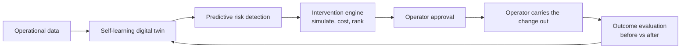

# LineZero 2.0: Adaptive Intelligence

*Predict. Understand. Intervene. Learn.*

LineZero 2.0 closes the loop around the existing Digital Twin:



LineZero detects, simulates and recommends. **People approve and carry out every change.** LineZero never edits a
counter, queue or customer as a result of an intervention (`executed_by_linezero` is always `false`, enforced by a
database `CHECK` constraint).

## Data honesty

Every adaptive response carries a `provenance` block, and every number is one of five kinds:

| Kind | Meaning |
|---|---|
| observed | Measured from the queue database. On a synthetic queue it is *synthetic*, never "real". |
| synthetic | Generated demo data (`is_synthetic`). Results computed on it are demonstrations only. |
| simulated | Produced by the SimPy twin: a what-if state, not an observation. |
| predicted | A model estimate (calibrated formula, forecast) with stated uncertainty. |
| explanation | Deterministic text assembled from the numbers. No generative AI is used by these modules. |

No risk score is random, and no accuracy figure is claimed anywhere: every metric shown is computed from the data on screen.

## 1. Adaptive calibration (`calibration_engine`, `drift_detection_engine`)

* Learns arrival and service rates per queue and per counter. Gamma-Poisson posterior for arrivals, Gamma posterior for
  exponential service rates; per-counter rates are shrunk towards the pooled rate; the active version acts as a
  weight-capped prior (`prior_arrival_minutes`, `prior_service_pseudo_n`).
* **No leakage.** Chronological split. Training uses only arrivals up to the cut-off and services that *finished* by it.
  Validation customers arrive later and are scored with the queue state they actually found.
* **Validation gate.** A candidate becomes a new version only if validation MAE improves by at least
  `min_improvement_pct` (default 1%). Otherwise it is stored as `rejected` (no version number) so the audit trail explains why nothing changed.
* Wait prediction: `max(queue_ahead + 1 - idle, 0) / total_service_rate x 60` (same formula as the existing baseline predictor).
  Metrics: MAE, RMSE, bias, MAPE (only where the actual wait is at least 30 s).
* Confidence = `min(1, n_validation/100) x (1 - relative half-width of the 95% interval of the pooled service rate)`.
  It is a data-sufficiency measure, not an accuracy guarantee.
* **Versioning.** Append-only, per queue. A rollback restores an old version's parameters as a *new* version.
  A partial unique index guarantees one active version per queue.
* **Drift.** Exact Poisson-rate test (arrivals), two-sample KS (service times) and a Welch t-test on 30-minute block
  means (waits; individual waits are autocorrelated and would over-alarm). A signal drifts only if
  `p < alpha/3` (Bonferroni) **and** the effect is practically large (>= 15%; waits also >= 0.25 min).

## 2. Operational risk engine (`risk_engine`)

Seven categories, always all scored, from observed data and the twin's forecast. Severity bands: Low >= 0.2, Medium >= 0.4,
High >= 0.6, Critical >= 0.8. Every assessment lists its inputs, its formula and a confidence based on how much data supports it.

| Category | Score |
|---|---|
| Queue congestion | `0.4 load + 0.3 queue + 0.3 forecast congestion probability` (1.0 with no active counter) |
| Counter overload | `clamp((utilization - 0.75) / 0.25)` per counter |
| Rising waiting times | `0.5 level + 0.5 trend` (trend only if Kendall p < 0.05 and rising) |
| Capacity shortage | `clamp((load ratio - 0.85) / 0.35)` |
| Counter failure precursor | `max(stall, degradation)`; an **early-warning signal only**, never "the counter has failed" |
| Abnormal arrivals | `clamp((\|relative change\| - 0.15) / 0.85)` if exact Poisson test p < 0.01; drops are capped at LOW |
| Utilization imbalance | `clamp((max - min utilization - 0.25) / 0.5) x clamp(mean utilization / 0.6)` |

Utilization is measured against the whole window; historical pauses of a counter are not recorded, and the response says so.
Too little data gives `insufficient_data`, not a guess. Scans can be stored as `risk_events` (open events refresh,
undetected ones resolve; an operator can also resolve them).

## 3. Intervention engine (`intervention_engine`)

Candidates (only the feasible ones are evaluated; the others are listed with the reason): open 1 to 3 reserve counters,
assist staff (+15% / +30% speed), divert 10% / 20% of arrivals, change the assignment rule, and a combination.

* The baseline (nothing changes) and every candidate run on the **same random seeds** (common random numbers), so the
  paired difference isolates the intervention from simulation noise. Same inputs and seed give identical results; the
  response includes a `config_hash`.
* `score = avg_wait + 0.5 x p95 + 20 x abandonment` (minutes-equivalent, lower is better).
* Cost = counter-hours + assisting staff + diverted customers, from an **operator-supplied** cost model (it is not measured data).
* `net_value = (baseline_score - score) - cost_weight x extra_cost`. A candidate is **recommended** only if its improvement is
  clear beyond simulation noise (paired 95% interval) and its net value is positive; otherwise the engine says that no
  candidate clearly helps.
* Not measured, listed with every result: the +15% / +30% speed-ups, the staff they need, the diversion share, and the cost figures. Service times are exponential, rates are constant over the horizon, nobody abandons, no counter fails.

Workflow (every step records who and when):

```
proposed --approve--> approved --applied--> applied --outcome--> evaluated
    \--reject--> rejected        \--reject--> rejected
```

* `approved` only records the decision. `applied` means *the operator confirms they carried the change out* (not in the future, not before the approval). Only one candidate per evaluation can be taken forward.

## 4. Outcome learning (`outcome_engine`)

* **Observe**: compares the window before the confirmed `applied_at` with the window after it (customers by service-start time). The post window must have elapsed and both windows need at least 10 customers; otherwise nothing is recorded (409).
  The reduction interval is a Welch interval on 15-minute block means. Customers who queued before the change but were served after it count in the "after" window, which *under*-states an improvement.
* A before/after comparison is not a controlled experiment. The arrival-rate change and any other intervention in the windows are reported as confounders.
* **Verification labels**: `verified_real_observation` (measured on a real queue), `synthetic_observation` (measured on synthetic data, never "verified") and `operator_reported` (typed in; never measured by LineZero).
* Only verified real, confounder-free outcomes are `calibration_eligible`. The error statistics (expected vs observed reduction) include **only** verified real outcomes; the other kinds are counted separately. With fewer than 5 verified real outcomes no judgement about the model is made. The advice to recalibrate is advisory; LineZero does not change the model on its own.
* Arrival windows of operator-applied demand-changing interventions (traffic diversion) are excluded when the arrival rate is learned.

## 5. Operations loop

`GET /operations/{queue}/overview` shows where each stage stands (counts only). `POST /operations/{queue}/cycle` runs the
*automatic* stages (recalibrate through the validation gate, scan risks, simulate interventions for the worst risk) and
never approves, applies or changes anything.

## Database

Migration `0003_adaptive_intelligence` adds `calibration_records`, `calibration_evaluations`, `risk_events` and
`intervention_history`. It only creates tables; nothing existing is altered. `alembic downgrade 0002` removes them.

## Limitations

* Service times are modelled as exponential and rates as constant within a horizon; real service times may differ.
* The calibrated wait predictor is a queueing formula, not a learned model; its accuracy is whatever the validation shows on your data.
* Simulated expectations are not verified outcomes. Before/after outcomes can be confounded.
* Interventions are never executed by LineZero. There is no authentication or role model; the operator name is a free-text audit field.
* Live queues use the wall clock as "now"; synthetic queues use their latest activity, so risk and intervention views on seeded data describe a past moment.
* Seeded demo data is synthetic: nothing computed from it is a real-world result.
